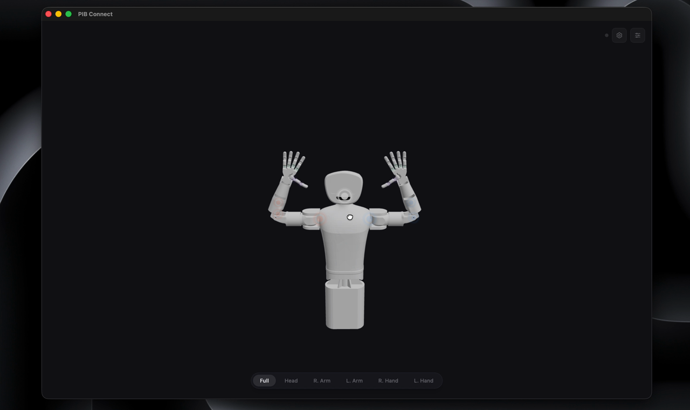
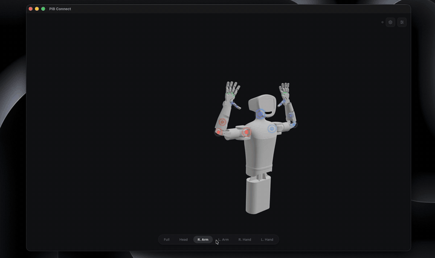

# PIB Connect

A 3D digital twin of the [pib](https://pib.rocks) humanoid robot that stays in sync with the real
robot in real time. Move the model and the robot moves, move the robot and the model follows.





PIB Connect is a desktop application for controlling and visualizing a physical PIB
robot in real time. It acts as a digital twin and combines a modern 3D interface
with low-latency hardware control, programming, and an AI assistant.

## Highlights

- Real-time URDF-driven 3D visualization with Maya/Blender-style rotation gizmos
- Two parallel control paths: pib-backend REST/ROSBridge and a Tauri/Rust direct serial layer (reserve)
- Smart Connect — automatic robot discovery on the local network (mDNS + last-known IP probe)
- Pose editor with multi-step pose workflows, loop mode, and step delays
- Blockly + Python authoring with a simulator-first execution model
- Built-in AI assistant: multi-session chat, custom personalities, vision input
- Cross-platform desktop builds via Tauri (macOS, Linux, Windows)

## Feature Set

### Workspace and Project Lifecycle

- In-app project browser for creating, opening, loading, and deleting projects
- Two project types:
	- `code`: full workflow with 3D, controls, poses, Blockly, Python, and AI
	- `live`: focused live-control workflow that opens straight into the 3D view
- Local project persistence plus file-based save/load (`.pib` JSON)
- Split-view mode between 3D scene and editor tabs with a draggable divider
- Top-level tabs: Live, Controls, Poses, Blocks, Python, AI

### Digital Twin and Live Robot Control

- URDF-based 3D model rendering with real-time joint updates
- View presets for full robot, head, right arm, left arm, right hand, left hand
- 30 controllable joints across neck, both arms, and both hands
- Direct 3D manipulation: click a body part to select, then grab one of the
  colored rotation arcs to rotate that joint
- Plane-projection rotation gizmo: grab anywhere on the arc, circle the joint
  pivot, the joint follows your gesture 1:1 (independent of camera angle)
- Two-axis combined handles for the neck and shoulders
- One-point hand-grip handle for curling all fingers in one gesture
- Body-collision prevention via URDF joint limits in normal mode (bypassed
  intentionally in pairing mode for motor-zero calibration)
- Floating camera controls: zoom in/out, reset zoom, reset robot pose
- Smooth-chase ease on every drag for a soft, weighted "Figma-grade" feel

### Controls, Poses, and Workflows

- Controls tab with dedicated sections:
	- Motors: joint sliders, grouping, and quick reset
	- Poses: save current pose and manage reusable poses
	- Camera: live feed and camera settings
- Pose management features:
	- Save, apply, rename, delete poses
	- Per-project pose scope
	- Local persistence with best-effort backend sync
- Pose Workflow editor:
	- Build multi-step pose sequences
	- Per-step delay
	- Reorder steps
	- Play, stop, optional loop mode

### Programming (No-Code + Python)

- Blockly editor with dark theme and autosave
- PIB-specific Blockly blocks:
	- move to pose
	- set motor
	- wait
	- repeat
	- print
- Automatic Python generation from the Blockly workspace
- Monaco-based Python editor for direct code editing
- Embedded run console with live output, auto-scroll, and clear

### Execution Targets and Runtime

- Explicit execution target switch:
	- Simulator (default)
	- Real robot
- Run and stop controls in both UI and desktop menu
- Safety rule: robot execution is blocked while the backend is unreachable
- Local simulator for Blockly programs and a constrained PIB-style Python subset
- Stop behavior restores the simulator start pose
- Backend execution flow for real-robot programs via the pib-backend program API

### AI Assistant and Chat

- Dedicated AI tab with:
	- Chat sidebar and multiple chat sessions
	- Streaming-style response UX in the chat panel
	- Input panel with optional speech/voice controls
	- Vision preview component for image-aware models
- Personality support:
	- Select among shipped personalities
	- Edit name, prompt/description, gender, language, and assigned model
- Model endpoint options:
	- pib-backend
	- TRYB
	- Custom endpoint
- Token-aware request handling for managed API keys
- Vision-capable model indicators

### Camera and Media Controls

- Embedded camera feed in the Controls tab
- Streaming via MJPEG and ROSBridge modes
- Automatic fallback from MJPEG to ROSBridge when needed
- Retry handling and stream-status indicators
- Camera settings controls for quality, refresh rate, and resolution

### Connectivity, Settings, and Safety

- Smart Connect: automatic robot discovery via `pib.local` mDNS, NetBIOS short
  name, and the last-known saved IP — no manual setup on most home networks
- Connection settings for robot IP, REST API port, and ROSBridge port
- Backend health test, status indicator, and 30-second background polling
- Mock mode for hardware-free workflows
- Runtime ROSBridge initialization/disconnect based on backend availability
- Toast-based feedback for connection events, robot actions, and errors
- Dedicated Settings window tabs: Connection, AI, Motor Controls, Calibration,
  Debug, About

### Calibration and Motor Alignment

- Step-by-step calibration wizard with body-part progression
- Three-point capture per joint (min, neutral, max) with live 3D preview
- Pairing mode for aligning the 3D pose with the real robot before applying
- Per-joint visual alignment helpers: invert direction, 180-degree half-turn
- Import / export of complete motor-configuration snapshots (calibration data,
  overrides, joint-invert flags) as portable JSON

### Desktop Integration (Tauri)

- Native desktop menus for file, view, program, settings, and help actions
- Keyboard shortcuts for common actions (new/open/save/run/stop/settings/tabs)
- Native open/save dialogs
- Separate Tauri windows for project and settings flows
- Multi-platform release workflow with signed builds for macOS, Linux, Windows

### Design System

- Token-driven dark theme defined in `src/index.css`: surfaces, borders, text,
  and accent palette
- Shared primitives: `Button`, `IconButton`, `Navbar`, `ToastContainer`
- Unified motion language: 150–250 ms durations with `cubic-bezier(0.32, 0.72, 0, 1)`
  (the iOS drawer curve) and explicit transitioned properties — no `transition: all`
- Respects `prefers-reduced-motion`
- Focus-visible rings on all interactive elements for keyboard accessibility

### API and Transport Capabilities

- Mainline control path:
	- pib-backend REST APIs
	- ROSBridge for live trajectory and motion messaging
- Additional client API surfaces in the codebase:
	- motors, poses, programs
	- camera settings
	- chat, personality, assistant-model endpoints
	- bricklet endpoints
- Direct serial transport remains available in Tauri/Rust as a reserve capability

## Tech Stack

- Frontend: React, TypeScript, Vite, React Three Fiber, Zustand, Tailwind CSS 4
- Backend: Rust, Tauri 2, tokio, serialport
- Package manager: pnpm

## Getting Started

```bash
pnpm install
```

## Development

```bash
# Frontend only
pnpm dev

# Full desktop app (frontend + Tauri backend)
pnpm tauri dev

# Type checking
tsc --noEmit
```

## Build

```bash
pnpm build
pnpm tauri build
```

## Project Structure

- `src/` — React frontend, state stores, UI primitives, and the 3D viewer
- `src-tauri/` — Rust/Tauri backend, commands, and serial communication
- `docs/` — Product and feature documentation


## Documentation

- `docs/features.md` — full feature inventory and implementation status
- `docs/prd.md` — product requirements and scope
- `docs/pib-backend-functionality.md` — backend capability overview

## Requirements

- [Node.js](https://nodejs.org) 20+ and [pnpm](https://pnpm.io)
- For the desktop app: [Rust](https://rustup.rs) and the
  [Tauri 2 prerequisites](https://tauri.app/start/prerequisites/) for your OS
- A pib running [pib-backend](https://github.com/pib-rocks/pib-backend) on your network (optional:
  without a robot the app runs in simulator/mock mode)

To point the dev server at your robot, see `.env.example` or use Settings → Connection in the app.

## Credits and licenses

- The pib robot, its 3D model and the pib software are by [pib.rocks](https://pib.rocks) and
  contributors. The model in `public/pib_V3_urdf (1)/` is redistributed under AGPL-3.0, see its
  [NOTICE.md](<public/pib_V3_urdf (1)/NOTICE.md>).
- PIB Connect's own code is [MIT](LICENSE) licensed.
- PIB Connect is an independent community project and is not affiliated with pib.rocks.
